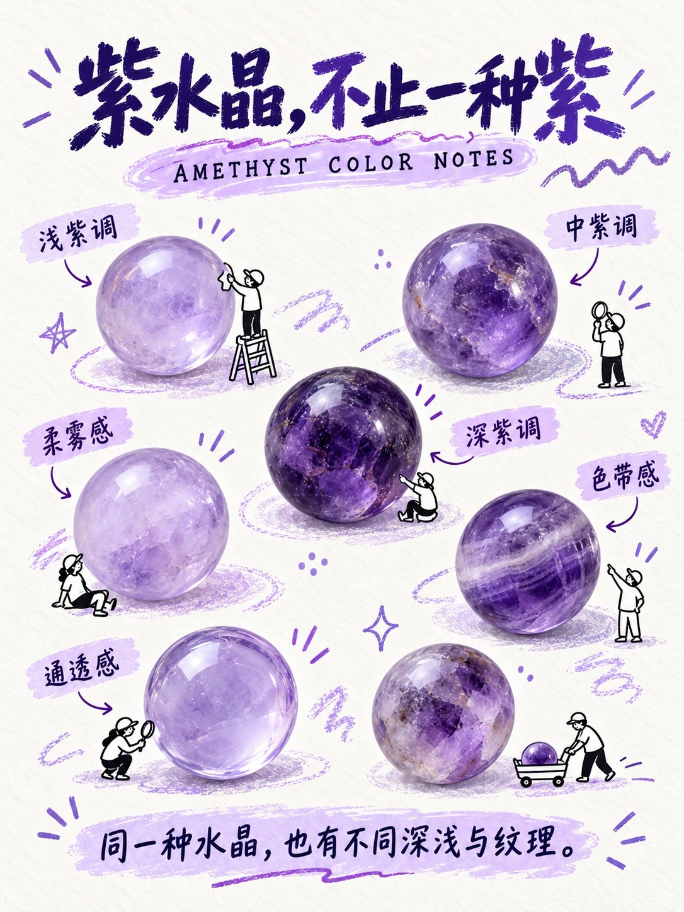
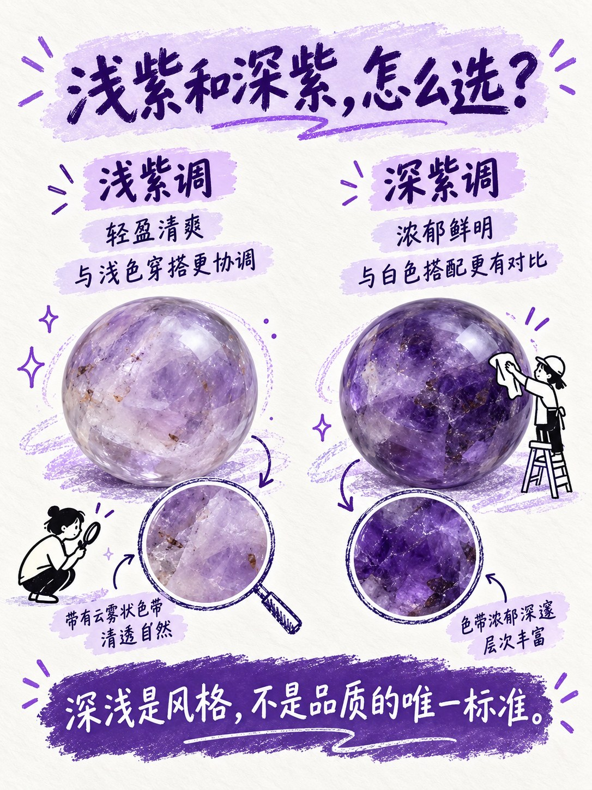
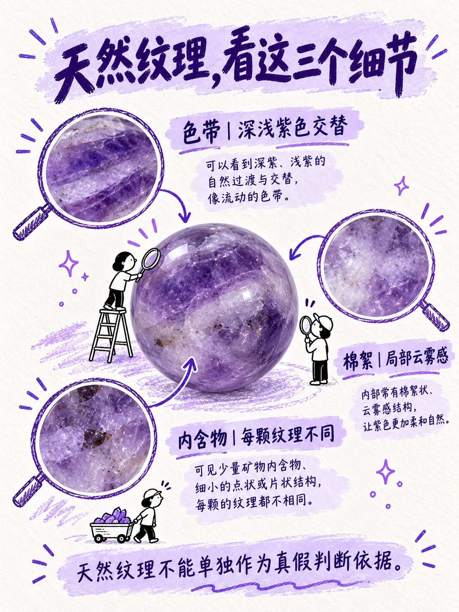
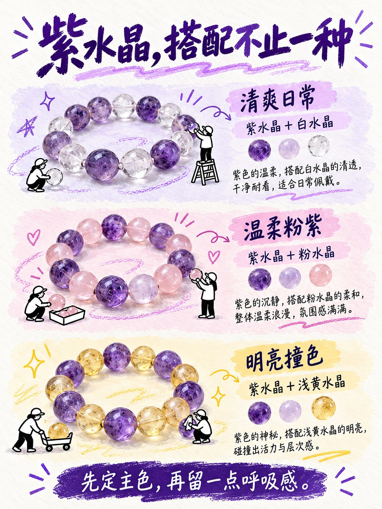
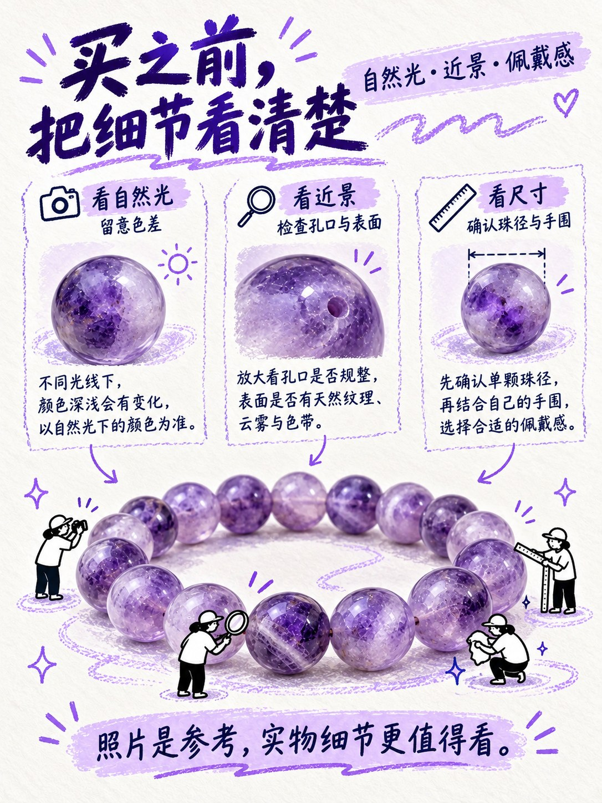
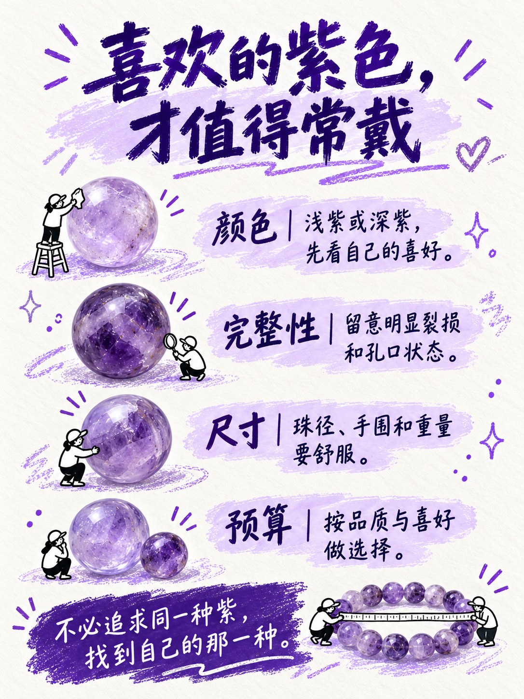

# 水晶手绘图鉴

一套制作六张独立水晶图鉴海报的 Skill：暖白纸底、手写标题、自然矿物质感、原创手绘小人，每页使用不同排版。

## 给 AI 的指令

请读取本仓库的 SKILL.md，并查看 assets 中六张参考图。按照这套风格，为【你的主题】制作六张独立 3:4 海报，各页排版不同，加入与珠子互动的手绘小人，无页码、署名和广告。

[读取 Skill](SKILL.md)

## 六种参考布局

## 安装

下载本仓库，将整个文件夹放入你的 AI 工具支持的 skills 目录。具体安装方式取决于所用工具；仅粘贴链接并不代表自动安装。
